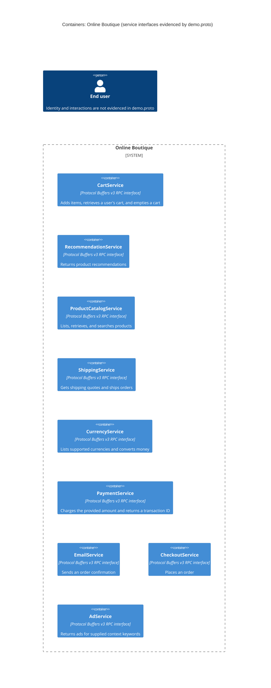
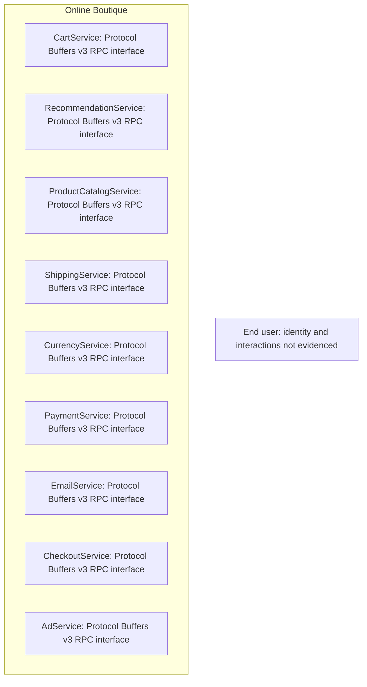

# Online Boutique: Recovered Architecture (Run A)

## Agent

OpenAI Codex, GPT-6 (exact model variant not exposed).

## Files read

- `prompts/1-recover-architecture.md`
- `system/online-boutique/protos/demo.proto`
- `exercise/outputs/1A-architecture.md` (read back to verify the generated output)

## Containers table

The proto defines nine named RPC service interfaces. The table and diagram represent those interfaces as logical service containers; this file does not establish their deployed process boundaries or implementation languages.

| Name | Technology/language | Responsibility | Evidence |
|---|---|---|---|
| CartService | Protocol Buffers v3 RPC interface; implementation language not evidenced | Adds items, retrieves a user's cart, and empties a cart | `system/online-boutique/protos/demo.proto` — `service CartService`, `AddItem`, `GetCart`, `EmptyCart` |
| RecommendationService | Protocol Buffers v3 RPC interface; implementation language not evidenced | Returns product recommendations | `system/online-boutique/protos/demo.proto` — `service RecommendationService`, `ListRecommendations` |
| ProductCatalogService | Protocol Buffers v3 RPC interface; implementation language not evidenced | Lists, retrieves, and searches products | `system/online-boutique/protos/demo.proto` — `service ProductCatalogService`, `ListProducts`, `GetProduct`, `SearchProducts` |
| ShippingService | Protocol Buffers v3 RPC interface; implementation language not evidenced | Gets shipping quotes and ships orders | `system/online-boutique/protos/demo.proto` — `service ShippingService`, `GetQuote`, `ShipOrder` |
| CurrencyService | Protocol Buffers v3 RPC interface; implementation language not evidenced | Lists supported currencies and converts money | `system/online-boutique/protos/demo.proto` — `service CurrencyService`, `GetSupportedCurrencies`, `Convert` |
| PaymentService | Protocol Buffers v3 RPC interface; implementation language not evidenced | Charges the provided amount and returns a transaction ID | `system/online-boutique/protos/demo.proto` — `service PaymentService`, `Charge` |
| EmailService | Protocol Buffers v3 RPC interface; implementation language not evidenced | Sends an order confirmation | `system/online-boutique/protos/demo.proto` — `service EmailService`, `SendOrderConfirmation` |
| CheckoutService | Protocol Buffers v3 RPC interface; implementation language not evidenced | Places an order | `system/online-boutique/protos/demo.proto` — `service CheckoutService`, `PlaceOrder` |
| AdService | Protocol Buffers v3 RPC interface; implementation language not evidenced | Returns ads for supplied context keywords | `system/online-boutique/protos/demo.proto` — `service AdService`, `GetAds`, `AdRequest.context_keys` |

## Dependencies table

No runtime caller-to-callee dependencies are evidenced in the provided file. It declares RPC methods and their message types, but not which component invokes them.

| Caller → callee | Protocol | Evidence |
|---|---|---|

## Mermaid diagram

### Zed-compatible fallback

If this Zed version does not render the C4 diagram above, this standard Mermaid flowchart shows the same service-interface nodes. It adds no caller-to-callee links because none are evidenced.

## Gaps

- **Runtime dependencies and protocols:** Not evidenced in the provided file. A caller's service implementation or client-wiring configuration showing which RPC stubs it invokes and how targets are addressed would settle this.
- **Deployed container boundaries and implementation technologies:** The proto names service interfaces but does not show whether each runs as a separate process or its implementation language. Service entry-point/build files and deployment manifests would settle this.
- **Data stores and external systems:** None are described. The relevant service implementation or storage/integration configuration would identify them.
- **End-user identity and entry point:** Not evidenced. A frontend or user-facing entry-point file would identify the actor and its connection to the system.
