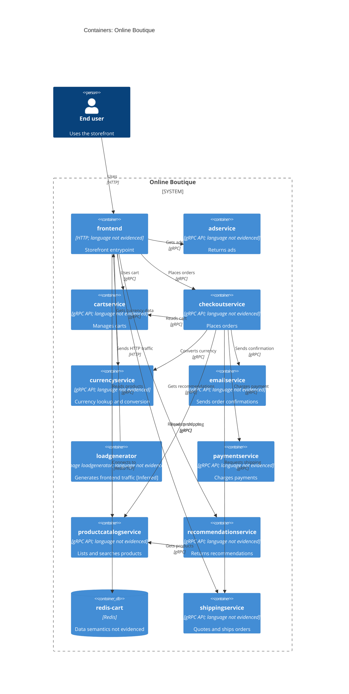
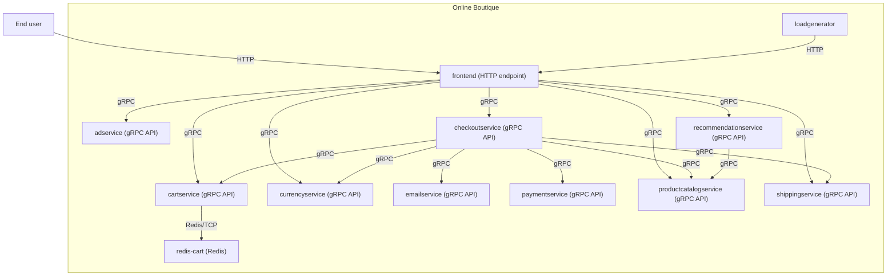

# Recovered C4 Container Architecture — Run B

## Agent

OpenAI Codex — GPT-6.

## Files read

- prompts/1-recover-architecture.md
- system/online-boutique/protos/demo.proto
- system/online-boutique/kubernetes-manifests/README.md
- system/online-boutique/kubernetes-manifests/adservice.yaml
- system/online-boutique/kubernetes-manifests/cartservice.yaml
- system/online-boutique/kubernetes-manifests/checkoutservice.yaml
- system/online-boutique/kubernetes-manifests/currencyservice.yaml
- system/online-boutique/kubernetes-manifests/emailservice.yaml
- system/online-boutique/kubernetes-manifests/frontend.yaml
- system/online-boutique/kubernetes-manifests/kustomization.yaml
- system/online-boutique/kubernetes-manifests/loadgenerator.yaml
- system/online-boutique/kubernetes-manifests/paymentservice.yaml
- system/online-boutique/kubernetes-manifests/productcatalogservice.yaml
- system/online-boutique/kubernetes-manifests/recommendationservice.yaml
- system/online-boutique/kubernetes-manifests/shippingservice.yaml
- exercise/outputs/1A-architecture.md (fallback format reference only; not architecture evidence)
- exercise/outputs/1B-architecture.md (prior output inspected for this rendering correction)

## Containers table

| Name | Technology/language | Responsibility | Evidence |
|---|---|---|---|
| frontend | HTTP endpoint; implementation language not evidenced | [Inferred] Storefront entrypoint; exposed through an HTTP Service. | system/online-boutique/kubernetes-manifests/frontend.yaml (Deployment/frontend; frontend-external Service, HTTP port 80 → targetPort 8080, lines 16–18, 124–136) |
| adservice | gRPC API; implementation language not evidenced | Returns ads (AdService.GetAds). | system/online-boutique/kubernetes-manifests/adservice.yaml (Deployment/adservice, lines 16–18); system/online-boutique/protos/demo.proto (AdService.GetAds, lines 243–244) |
| cartservice | gRPC API; implementation language not evidenced | Adds, reads, and empties carts (CartService RPCs). | system/online-boutique/kubernetes-manifests/cartservice.yaml (Deployment/cartservice, lines 16–18); system/online-boutique/protos/demo.proto (CartService, lines 23–26) |
| checkoutservice | gRPC API; implementation language not evidenced | Places orders (CheckoutService.PlaceOrder). | system/online-boutique/kubernetes-manifests/checkoutservice.yaml (Deployment/checkoutservice, lines 16–18); system/online-boutique/protos/demo.proto (CheckoutService.PlaceOrder, lines 224–225) |
| currencyservice | gRPC API; implementation language not evidenced | Lists supported currencies and converts money (CurrencyService RPCs). | system/online-boutique/kubernetes-manifests/currencyservice.yaml (Deployment/currencyservice, lines 16–18); system/online-boutique/protos/demo.proto (CurrencyService, lines 140–142) |
| emailservice | gRPC API; implementation language not evidenced | Sends order confirmations (EmailService.SendOrderConfirmation). | system/online-boutique/kubernetes-manifests/emailservice.yaml (Deployment/emailservice, lines 16–18); system/online-boutique/protos/demo.proto (EmailService.SendOrderConfirmation, lines 199–200) |
| loadgenerator | Image loadgenerator; language not evidenced (init check uses BusyBox shell) | [Inferred] Generates frontend traffic; configured with FRONTEND_ADDR, USERS, and RATE. | system/online-boutique/kubernetes-manifests/loadgenerator.yaml (Deployment/loadgenerator, lines 15–19; FRONTEND_ADDR/USERS/RATE, lines 80–87) |
| paymentservice | gRPC API; implementation language not evidenced | Charges payments (PaymentService.Charge). | system/online-boutique/kubernetes-manifests/paymentservice.yaml (Deployment/paymentservice, lines 16–18); system/online-boutique/protos/demo.proto (PaymentService.Charge, lines 177–178) |
| productcatalogservice | gRPC API; implementation language not evidenced | Lists, retrieves, and searches products (ProductCatalogService RPCs). | system/online-boutique/kubernetes-manifests/productcatalogservice.yaml (Deployment/productcatalogservice, lines 16–18); system/online-boutique/protos/demo.proto (ProductCatalogService, lines 71–74) |
| recommendationservice | gRPC API; implementation language not evidenced | Returns product recommendations (RecommendationService.ListRecommendations). | system/online-boutique/kubernetes-manifests/recommendationservice.yaml (Deployment/recommendationservice, lines 16–18); system/online-boutique/protos/demo.proto (RecommendationService.ListRecommendations, lines 56–57) |
| redis-cart | Redis (image redis:alpine) | Redis endpoint configured for cartservice; stored data is not specified by the supplied files. | system/online-boutique/kubernetes-manifests/cartservice.yaml (Deployment/redis-cart and image, lines 90–120; cartservice REDIS_ADDR, lines 50–51) |
| shippingservice | gRPC API; implementation language not evidenced | Provides shipping quotes and ships orders (ShippingService RPCs). | system/online-boutique/kubernetes-manifests/shippingservice.yaml (Deployment/shippingservice, lines 16–18); system/online-boutique/protos/demo.proto (ShippingService, lines 107–109) |

## Dependencies table

The service-to-service rows represent configured addresses in the manifests whose target services are defined by the supplied manifests and protobuf contract.

| Caller → callee | Protocol | Evidence |
|---|---|---|
| End user → frontend | HTTP | system/online-boutique/kubernetes-manifests/frontend.yaml (frontend-external is LoadBalancer; port named http, 80 → 8080, lines 124–136) |
| frontend → productcatalogservice | gRPC | system/online-boutique/kubernetes-manifests/frontend.yaml (PRODUCT_CATALOG_SERVICE_ADDR, lines 69–70); system/online-boutique/protos/demo.proto (ProductCatalogService, lines 71–74) |
| frontend → currencyservice | gRPC | system/online-boutique/kubernetes-manifests/frontend.yaml (CURRENCY_SERVICE_ADDR, lines 71–72); system/online-boutique/protos/demo.proto (CurrencyService, lines 140–142) |
| frontend → cartservice | gRPC | system/online-boutique/kubernetes-manifests/frontend.yaml (CART_SERVICE_ADDR, lines 73–74); system/online-boutique/protos/demo.proto (CartService, lines 23–26) |
| frontend → recommendationservice | gRPC | system/online-boutique/kubernetes-manifests/frontend.yaml (RECOMMENDATION_SERVICE_ADDR, lines 75–76); system/online-boutique/protos/demo.proto (RecommendationService, lines 56–57) |
| frontend → shippingservice | gRPC | system/online-boutique/kubernetes-manifests/frontend.yaml (SHIPPING_SERVICE_ADDR, lines 77–78); system/online-boutique/protos/demo.proto (ShippingService, lines 107–109) |
| frontend → checkoutservice | gRPC | system/online-boutique/kubernetes-manifests/frontend.yaml (CHECKOUT_SERVICE_ADDR, lines 79–80); system/online-boutique/protos/demo.proto (CheckoutService, lines 224–225) |
| frontend → adservice | gRPC | system/online-boutique/kubernetes-manifests/frontend.yaml (AD_SERVICE_ADDR, lines 81–82); system/online-boutique/protos/demo.proto (AdService, lines 243–244) |
| checkoutservice → productcatalogservice | gRPC | system/online-boutique/kubernetes-manifests/checkoutservice.yaml (PRODUCT_CATALOG_SERVICE_ADDR, lines 57–58); system/online-boutique/protos/demo.proto (ProductCatalogService, lines 71–74) |
| checkoutservice → shippingservice | gRPC | system/online-boutique/kubernetes-manifests/checkoutservice.yaml (SHIPPING_SERVICE_ADDR, lines 59–60); system/online-boutique/protos/demo.proto (ShippingService, lines 107–109) |
| checkoutservice → paymentservice | gRPC | system/online-boutique/kubernetes-manifests/checkoutservice.yaml (PAYMENT_SERVICE_ADDR, lines 61–62); system/online-boutique/protos/demo.proto (PaymentService, lines 177–178) |
| checkoutservice → emailservice | gRPC | system/online-boutique/kubernetes-manifests/checkoutservice.yaml (EMAIL_SERVICE_ADDR, lines 63–64); system/online-boutique/protos/demo.proto (EmailService, lines 199–200) |
| checkoutservice → currencyservice | gRPC | system/online-boutique/kubernetes-manifests/checkoutservice.yaml (CURRENCY_SERVICE_ADDR, lines 65–66); system/online-boutique/protos/demo.proto (CurrencyService, lines 140–142) |
| checkoutservice → cartservice | gRPC | system/online-boutique/kubernetes-manifests/checkoutservice.yaml (CART_SERVICE_ADDR, lines 67–68); system/online-boutique/protos/demo.proto (CartService, lines 23–26) |
| recommendationservice → productcatalogservice | gRPC | system/online-boutique/kubernetes-manifests/recommendationservice.yaml (PRODUCT_CATALOG_SERVICE_ADDR, lines 60–61); system/online-boutique/protos/demo.proto (ProductCatalogService, lines 71–74) |
| cartservice → redis-cart | Redis/TCP | system/online-boutique/kubernetes-manifests/cartservice.yaml (REDIS_ADDR, lines 50–51; redis-cart Service port tcp-redis 6379, lines 144–156) |
| loadgenerator → frontend | HTTP | system/online-boutique/kubernetes-manifests/loadgenerator.yaml (wget http://${FRONTEND_ADDR}, lines 47–50; FRONTEND_ADDR=frontend:80, lines 82–83); system/online-boutique/kubernetes-manifests/frontend.yaml (HTTP Service port 80, lines 118–121) |

## Mermaid diagram

### Zed-compatible fallback

If this Zed version does not render the C4 diagram above, this standard Mermaid flowchart shows the same containers and dependency links as the tables.

## Gaps

- The implementation language of the application services and loadgenerator is not evidenced. demo.proto has a go_package option, but that does not establish the runtime implementation language. Service Dockerfiles/build files and implementation source would settle this.
- frontend.yaml configures SHOPPING_ASSISTANT_SERVICE_ADDR=shoppingassistantservice:80 (lines 83–84), but no matching deployment or API contract appears in the supplied evidence. I have not represented it as a dependency in the diagram. A shoppingassistantservice deployment manifest and the frontend client/API definition would settle whether it exists and which protocol it uses.
- The files do not show which data cartservice stores in Redis or the intended persistence behavior. The cartservice implementation and Redis storage configuration would settle that.
